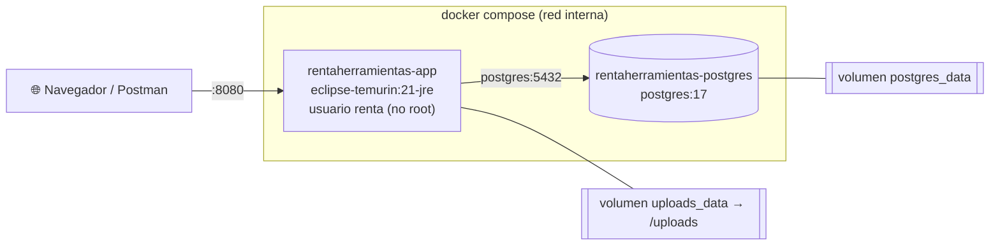

# 🚀 Despliegue

RentaHerramientas se despliega con **Docker** (opción elegida para el proyecto): una
imagen de la aplicación (API + frontend) y un contenedor de PostgreSQL 17, orquestados con
Docker Compose. Al final se explica la alternativa con **Tomcat nativo**.

## 1. Qué se levanta



| Servicio | Imagen | Puerto | Volumen | Healthcheck |
|---|---|---|---|---|
| `postgres` | `postgres:17` | `${POSTGRES_PORT:-5432}` | `postgres_data` | `pg_isready` |
| `app` | `rentaherramientas:latest` (se construye con el `Dockerfile`) | `${APP_PORT:-8080}` | `uploads_data` → `/uploads` | `curl /actuator/health` |

- `app` espera a que `postgres` esté **healthy** (`depends_on: condition: service_healthy`).
- Al arrancar, **Flyway** crea o actualiza el esquema; en perfil dev carga además los datos semilla.
- El `Dockerfile` es **multi-stage**: compila con `maven:3.9-eclipse-temurin-21` (con caché
  de dependencias de BuildKit) y la imagen final solo lleva el JRE 21 y el jar separado en
  capas, ejecutándose con el usuario sin privilegios `renta` (uid 10001).

## 2. Paso a paso con Docker 🐳

Requisito: Docker Desktop (o Docker Engine + Compose v2) encendido.

### 2.1 Configurar

```bash
cp .env.example .env              # PowerShell: Copy-Item .env.example .env
```

Edita `.env` y cambia como mínimo `POSTGRES_PASSWORD` y `JWT_SECRET`
(genera uno con `openssl rand -base64 48`). Si falta alguna variable obligatoria,
`docker compose` se detiene con un mensaje como
`required variable JWT_SECRET is missing a value: Define JWT_SECRET en .env (mínimo 32 bytes)`.

### 2.2 Construir y levantar

```bash
docker compose up --build         # en primer plano, con los logs en la terminal
docker compose up --build -d      # en segundo plano
```

El primer build tarda unos minutos (descarga dependencias de Maven); los siguientes
reutilizan la caché. La app queda lista cuando el log muestra
`Started RentaHerramientasApplication` y `docker compose ps` indica `(healthy)`.

### 2.3 Comandos del día a día

| Acción | Comando |
|---|---|
| Ver estado y salud | `docker compose ps` |
| Logs de la app (en vivo) | `docker compose logs -f app` |
| Logs de la base de datos | `docker compose logs -f postgres` |
| Reconstruir tras cambiar código | `docker compose up --build -d` |
| Reiniciar solo la app | `docker compose restart app` |
| Abrir `psql` | `docker compose exec postgres psql -U renta_user -d rentaherramientas` |
| Detener y borrar contenedores (**conserva los datos**) | `docker compose down` |
| Detener y borrar **también los volúmenes** (base e imágenes subidas) | `docker compose down -v` |
| Empezar desde cero | `docker compose down -v && docker compose up --build` |

> ⚠️ `down -v` elimina `postgres_data` y `uploads_data`: se pierden reservas, pagos e
> imágenes subidas. En dev la semilla se vuelve a cargar en el siguiente arranque.

## 3. Variables de entorno

Se leen del archivo `.env` (ver [.env.example](.env.example)). Docker Compose también
acepta variables del sistema, que tienen prioridad sobre `.env`.

| Variable | Obligatoria | Por defecto | Uso en Docker |
|---|---|---|---|
| `POSTGRES_DB` | ✅ | — | Nombre de la base (crea la BD y la usa la app) |
| `POSTGRES_USER` | ✅ | — | Usuario de PostgreSQL |
| `POSTGRES_PASSWORD` | ✅ | — | Contraseña de PostgreSQL |
| `POSTGRES_PORT` | | `5432` | Puerto **publicado en el host** (la app siempre usa `postgres:5432` internamente) |
| `POSTGRES_HOST` | | — | Se ignora en Docker (la app usa `postgres`); sirve para ejecutar sin Docker |
| `JWT_SECRET` | ✅ | — | Secreto HS256, mínimo 32 bytes |
| `JWT_EXPIRACION_MINUTOS` | | `60` | Duración del token |
| `SPRING_PROFILES_ACTIVE` | | `dev` | `dev` o `prod` |
| `APP_PORT` | | `8080` | Puerto publicado de la app |
| `ADMIN_EMAIL` / `ADMIN_PASSWORD` | | vacío | Administrador inicial (se crea si no existe) |
| `CORS_ALLOWED_ORIGINS` | | `http://localhost:5173` | Orígenes externos permitidos |
| `UPLOADS_DIR` | | — | Se ignora en Docker (la app usa `/uploads`, montado como volumen) |

## 4. Perfiles dev y prod

| | **dev** (por defecto) | **prod** |
|---|---|---|
| Datos semilla (`db/seed/V100`) | ✅ 1 admin, 20 proveedores, 25 clientes, 40 herramientas… | ❌ Base vacía |
| Usuarios de prueba (`Clave123*`) | ✅ | ❌ Solo el admin de `ADMIN_EMAIL` |
| Valores por defecto de conexión y JWT | ✅ | ❌ Todo debe venir de variables de entorno |
| SQL en el log / nivel de log de la app | ✅ / `DEBUG` | ❌ / `INFO` |
| `flyway clean` | Permitido | Deshabilitado |

### Usar el perfil prod

1. En `.env`:

   ```dotenv
   SPRING_PROFILES_ACTIVE=prod
   POSTGRES_PASSWORD=<contraseña larga y única>
   JWT_SECRET=<salida de: openssl rand -base64 48>
   ADMIN_EMAIL=admin@tu-dominio.co
   ADMIN_PASSWORD=<contraseña fuerte>
   ```

2. Usa una base **sin** datos semilla: si el volumen ya se usó en dev, bórralo
   (`docker compose down -v`) o define otro `POSTGRES_DB`.
3. Levanta: `docker compose up --build -d`.
4. Inicia sesión con `ADMIN_EMAIL` y crea las categorías; los proveedores y clientes se
   registran desde el frontend.

También se puede cambiar el perfil solo para una ejecución:
`SPRING_PROFILES_ACTIVE=prod docker compose up -d` (Linux/macOS) o
`$env:SPRING_PROFILES_ACTIVE="prod"; docker compose up -d` (PowerShell).

> 🔒 Para un servidor real: no publiques el puerto de PostgreSQL (quita `ports` del
> servicio `postgres`), pon la app detrás de un proxy con HTTPS y respalda el volumen
> `postgres_data` (`docker compose exec postgres pg_dump …`).

## 5. Verificación ✅

| Qué | Cómo | Esperado |
|---|---|---|
| Contenedores | `docker compose ps` | `rentaherramientas-app` y `rentaherramientas-postgres` en `Up (healthy)` |
| Salud | <http://localhost:8080/actuator/health> | `{"status":"UP", …}` |
| Frontend | <http://localhost:8080> | Página de inicio con buscador, categorías y herramientas destacadas |
| Login | <http://localhost:8080/login.html> con `andres.rueda@gmail.com` / `Clave123*` (dev) | Redirige a *Mis reservas* |
| Swagger UI | <http://localhost:8080/swagger-ui.html> | Documentación interactiva de todos los endpoints, agrupados por módulo |
| OpenAPI | <http://localhost:8080/v3/api-docs> | JSON de la especificación |
| Migraciones | `docker compose logs app \| grep -i flyway` | `Successfully applied … migrations` (o `Schema … is up to date`) |
| Usuario no root | `docker compose exec app id` | `uid=10001(renta)` |

Con `curl`:

```bash
curl -s http://localhost:8080/actuator/health
curl -s -X POST http://localhost:8080/api/auth/login \
  -H "Content-Type: application/json" \
  -d '{"email":"andres.rueda@gmail.com","password":"Clave123*"}'
```

---

## 6. Alternativa: Tomcat nativo 🐱

El enunciado acepta *Docker o Tomcat nativo*. El proyecto usa Docker; esta sección explica
qué haría falta para desplegarlo como **WAR** en un Tomcat instalado.

### 6.1 Versión de Tomcat: solo 11.0.x

| Tomcat | Jakarta Servlet | ¿Compatible con Spring Boot 4 / Spring Framework 7? |
|---|---|---|
| **11.0.x** | **6.1** | ✅ Sí (es la misma línea que Boot 4 trae embebida: 11.0.24) |
| 10.1.x | 6.0 | ❌ **No**: Spring Framework 7 exige Servlet 6.1 como mínimo |
| 9.x o anterior | `javax.servlet` 4.0 | ❌ No (espacio de nombres `javax`) |

Tomcat 11 además requiere **Java 17+**; para este proyecto se usa **Java 21**.

### 6.2 Empaquetar como WAR

Cambios (no están aplicados en el repositorio, que genera un jar ejecutable):

1. `bootstrap/pom.xml`: empaquetado `war` y Tomcat embebido como `provided` (el contenedor
   ya lo trae). En Spring Boot 4 el starter de Tomcat se divide y lo que se marca
   `provided` es su parte de *runtime*:

   ```xml
   <artifactId>bootstrap</artifactId>
   <packaging>war</packaging>

   <dependencies>
       <dependency>
           <groupId>org.springframework.boot</groupId>
           <artifactId>spring-boot-starter-tomcat-runtime</artifactId>
           <scope>provided</scope>
       </dependency>
       <!-- … dependencias actuales … -->
   </dependencies>
   ```

   > En Spring Boot 3 el equivalente era `spring-boot-starter-tomcat` con `provided`.

2. La clase principal extiende `SpringBootServletInitializer`, que es el punto de
   entrada cuando Tomcat despliega el WAR:

   ```java
   import org.springframework.boot.builder.SpringApplicationBuilder;
   import org.springframework.boot.web.servlet.support.SpringBootServletInitializer;

   @SpringBootApplication(scanBasePackages = "com.rentaherramientas")
   @EnableJpaRepositories(basePackages = "com.rentaherramientas.infrastructure")
   @EntityScan(basePackages = "com.rentaherramientas.infrastructure")
   public class RentaHerramientasApplication extends SpringBootServletInitializer {

       @Override
       protected SpringApplicationBuilder configure(SpringApplicationBuilder builder) {
           return builder.sources(RentaHerramientasApplication.class);
       }

       public static void main(String[] args) {
           SpringApplication.run(RentaHerramientasApplication.class, args);
       }
   }
   ```

3. Empaquetar: `mvn clean package` → `bootstrap/target/bootstrap-1.0-SNAPSHOT.war`
   (Tomcat embebido queda en `WEB-INF/lib-provided`, así el WAR sigue siendo ejecutable
   con `java -jar` y además desplegable).

### 6.3 Desplegar en Tomcat 11

1. Instala **Tomcat 11.0.x** y un **JDK 21** (`JAVA_HOME`).
2. Define las variables de entorno en `CATALINA_BASE/bin/setenv.sh` (o `setenv.bat`):

   ```bash
   export SPRING_PROFILES_ACTIVE=prod
   export POSTGRES_HOST=localhost POSTGRES_PORT=5432 POSTGRES_DB=rentaherramientas
   export POSTGRES_USER=renta_user POSTGRES_PASSWORD=...
   export JWT_SECRET=...  ADMIN_EMAIL=...  ADMIN_PASSWORD=...
   export UPLOADS_DIR=/var/lib/rentaherramientas/uploads
   ```

3. Copia el WAR como `CATALINA_BASE/webapps/ROOT.war` para servirlo en la raíz
   (`http://servidor:8080/`). El frontend usa rutas absolutas (`/api`, `/css`, `/js`), por
   eso debe desplegarse en el **contexto raíz** y no en `/bootstrap-1.0-SNAPSHOT/`.
4. Arranca Tomcat (`bin/startup.sh`) y verifica igual que en la [sección 5](#5-verificación-).

En este modo `server.port` y las opciones del servidor embebido no aplican: el puerto y
HTTPS se configuran en `conf/server.xml` de Tomcat.
