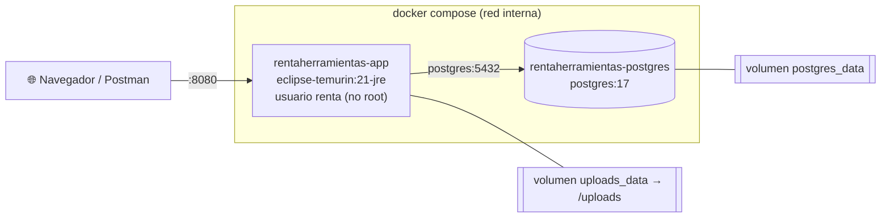

# 🚀 Despliegue

Guía para levantar RentaHerramientas con **Docker Compose** en **Windows**, **macOS** o
**Linux**. Elige la sección de tu sistema operativo; las secciones comunes (requisitos,
obtener el código, verificación y operaciones) valen para los tres.

## Contenido

1. [Qué se levanta](#1-qué-se-levanta)
2. [Requisitos comunes](#2-requisitos-comunes)
3. [Obtener el código (repositorio privado)](#3-obtener-el-código-repositorio-privado)
4. [Despliegue por sistema operativo](#4-despliegue-por-sistema-operativo)
   - [🪟 Windows (PowerShell)](#-windows-powershell)
   - [🍎 macOS (Terminal zsh)](#-macos-terminal-zsh)
   - [🐧 Linux (bash)](#-linux-bash)
5. [Verificación común](#5-verificación-común)
6. [Operaciones frecuentes](#6-operaciones-frecuentes)
7. [Variables de entorno](#7-variables-de-entorno)
8. [Perfiles dev y prod](#8-perfiles-dev-y-prod)
9. [Solución de problemas](#9-solución-de-problemas)
10. [Por qué Docker y no Tomcat nativo](#10-por-qué-docker-y-no-tomcat-nativo)

---

## 1. Qué se levanta

`docker compose` crea **dos contenedores** en una red interna privada:



| Servicio | Imagen | Puerto en el host | Volumen | Healthcheck |
|---|---|---|---|---|
| `postgres` | `postgres:17` | `${POSTGRES_PORT:-5432}` | `postgres_data` | `pg_isready` |
| `app` | `rentaherramientas:latest` (se construye con el `Dockerfile`) | `${APP_PORT:-8080}` | `uploads_data` → `/uploads` | `curl /actuator/health` |

Cómo se conectan:

- **Red interna de compose**: los contenedores se encuentran por el **nombre del servicio**.
  Por eso la app recibe `POSTGRES_HOST=postgres` y `POSTGRES_PORT=5432`, sin importar lo
  que diga el `.env` (esos valores son para ejecutar la app sin Docker).
- **Healthcheck**: `app` no arranca hasta que `postgres` está **healthy**
  (`depends_on: condition: service_healthy`). Al arrancar, **Flyway** crea o actualiza el
  esquema; en perfil dev carga además los datos semilla.
- **Volúmenes**: `postgres_data` guarda la base de datos y `uploads_data` las imágenes
  subidas. Sobreviven a `docker compose down`; solo se borran con `down -v`.
- **Imagen de la app**: el `Dockerfile` es *multi-stage*. Compila con
  `maven:3.9-eclipse-temurin-21` y la imagen final solo lleva el JRE 21 y el jar separado
  en capas, ejecutándose con el usuario sin privilegios `renta` (uid 10001).

## 2. Requisitos comunes

| Requisito | Detalle |
|---|---|
| **Git** | Para clonar el repositorio (opcional si descargas el ZIP). |
| **Docker con Compose v2** | El comando es `docker compose` (con espacio). Compruébalo con `docker compose version`. |
| **Puertos libres** | `8080` (app) y `5432` (PostgreSQL). Si están ocupados, cámbialos en `.env` con `APP_PORT` y `POSTGRES_PORT`. |
| **Internet en el primer build** | Se descargan las imágenes base y las dependencias de Maven: **5-10 minutos** la primera vez. Los siguientes builds reutilizan la caché y tardan mucho menos. |
| **Recursos** | Unos 4 GB de RAM libres para Docker y 3 GB de disco para imágenes y caché. |

No hace falta instalar Java, Maven ni PostgreSQL: todo corre dentro de los contenedores.

## 3. Obtener el código (repositorio privado)

El repositorio es **privado**, así que necesitas una cuenta de GitHub con acceso a él.

### Opción A: descargar el ZIP

1. Inicia sesión en GitHub y abre el repositorio.
2. Pulsa **Code → Download ZIP** y descomprímelo.
3. Abre una terminal **dentro de la carpeta descomprimida** (la que contiene
   `docker-compose.yml`).

> 🔐 Si usas un equipo ajeno (sala de cómputo, equipo prestado), **cierra la sesión de
> GitHub** en el navegador al terminar.

### Opción B: `git clone` con un Personal Access Token

GitHub **ya no acepta la contraseña** de la cuenta para operaciones de Git por HTTPS; se usa
un **token**:

1. En GitHub: **Settings → Developer settings → Personal access tokens → Fine-grained
   tokens → Generate new token**.
2. En *Repository access* elige **solo este repositorio** y en *Permissions → Contents*
   marca **Read-only**. Pon una fecha de expiración corta.
3. Clona y, cuando Git pida la contraseña, **pega el token**:

   ```bash
   git clone https://github.com/<usuario>/proyecto-rentaherramientas.git
   cd proyecto-rentaherramientas
   ```

> 🔐 Trata el token como una contraseña: no lo pegues en archivos del proyecto ni en chats.
> En un equipo ajeno, revócalo al terminar (o borra la credencial guardada por Git).

---

## 4. Despliegue por sistema operativo

Todas las secciones siguen los mismos pasos: **instalar → copiar `.env` → editar `.env` →
revisar puertos → construir y levantar → ver logs → abrir la app → detener**.

En el `.env` cambia como mínimo:

- `POSTGRES_PASSWORD`: una contraseña propia.
- `JWT_SECRET`: un secreto aleatorio de **al menos 32 bytes**. Puedes generarlo con
  `openssl rand -base64 48` (macOS/Linux, o Git Bash en Windows).

Si falta una variable obligatoria, `docker compose` se detiene con un mensaje como
`required variable JWT_SECRET is missing a value: Define JWT_SECRET en .env (mínimo 32 bytes)`.

### 🪟 Windows (PowerShell)

**1. Instalar requisitos**

1. Instala **Docker Desktop** para Windows y, durante la instalación, deja marcada la opción
   **Use WSL 2 instead of Hyper-V**. Si Windows pide instalar o actualizar WSL, hazlo
   (desde PowerShell como administrador: `wsl --install` o `wsl --update`) y reinicia.
2. Abre Docker Desktop y espera a que indique **Engine running**.
3. Instala **Git for Windows** si vas a clonar (opción B).
4. Comprueba en PowerShell:

   ```powershell
   docker --version
   docker compose version
   ```

**2. Preparar el `.env`**

```powershell
cd C:\ruta\a\proyecto-rentaherramientas
Copy-Item .env.example .env
notepad .env
```

Guarda el archivo en Notepad sin cambiarle el nombre (debe quedar `.env`, no `.env.txt`).

**3. Verificar que los puertos estén libres**

```powershell
Get-NetTCPConnection -LocalPort 8080,5432 -ErrorAction SilentlyContinue
```

Si no muestra nada, los puertos están libres. Si aparece alguna fila, otro programa los usa
(con frecuencia un PostgreSQL instalado en Windows): detén ese servicio o cambia `APP_PORT`
o `POSTGRES_PORT` en el `.env`.

**4. Construir y levantar**

```powershell
docker compose up --build -d
docker compose ps
```

**5. Ver logs**

```powershell
docker compose logs -f app
docker compose logs app | findstr /i flyway
```

`Ctrl + C` deja de seguir los logs sin detener los contenedores. En PowerShell no existe
`grep`; usa `findstr` (o `Select-String`).

**6. Abrir la app**

```powershell
Start-Process http://localhost:8080
curl.exe -s http://localhost:8080/actuator/health
```

> ⚠️ En Windows PowerShell 5.1, `curl` es un alias de `Invoke-WebRequest`, que tiene otra
> sintaxis. Escribe siempre **`curl.exe`** para usar el curl real incluido en Windows.

Login de prueba con `curl.exe` en Windows PowerShell 5.1 (las comillas internas del JSON
se escapan con `\"`; el acento grave `` ` `` al final de línea continúa el comando):

```powershell
curl.exe -s -X POST http://localhost:8080/api/auth/login `
  -H "Content-Type: application/json" `
  -d '{\"email\":\"andres.rueda@gmail.com\",\"password\":\"Clave123*\"}'
```

En PowerShell 7.3 o superior el JSON va sin escapar:
`-d '{"email":"andres.rueda@gmail.com","password":"Clave123*"}'`.

**7. Detener y limpiar**

```powershell
docker compose down          # detiene y borra contenedores; conserva los datos
docker compose down -v       # además borra los volúmenes (base de datos e imágenes)
```

### 🍎 macOS (Terminal zsh)

**1. Instalar requisitos**

1. Instala **Docker Desktop** para Mac eligiendo el instalador de tu procesador:
   **Apple Silicon** (M1, M2, M3…) o **Intel** ( → *Acerca de este Mac* lo indica).
   Las imágenes usadas (`postgres:17`, `maven:3.9-eclipse-temurin-21`,
   `eclipse-temurin:21-jre`) tienen versión **arm64**, así que en Apple Silicon corren de
   forma nativa, sin emulación.
2. Abre Docker Desktop y espera a que indique **Engine running**.
3. Git viene con las *Command Line Tools*: si `git --version` lo pide, acepta instalarlas
   (o ejecuta `xcode-select --install`).
4. Comprueba:

   ```zsh
   docker --version
   docker compose version
   ```

**2. Preparar el `.env`**

```zsh
cd ~/ruta/a/proyecto-rentaherramientas
cp .env.example .env
open -e .env
```

`open -e` abre el archivo en TextEdit. Los archivos que empiezan por punto están ocultos en
Finder (`Cmd + Shift + .` los muestra).

**3. Verificar que los puertos estén libres**

```zsh
lsof -i :8080
lsof -i :5432
```

Si no muestran nada, están libres. Si aparece un proceso (por ejemplo un PostgreSQL de
Homebrew: `brew services stop postgresql`), detenlo o cambia `APP_PORT` / `POSTGRES_PORT`
en el `.env`.

**4. Construir y levantar**

```zsh
docker compose up --build -d
docker compose ps
```

**5. Ver logs**

```zsh
docker compose logs -f app
docker compose logs app | grep -i flyway
```

**6. Abrir la app**

```zsh
open http://localhost:8080
curl -s http://localhost:8080/actuator/health
```

**7. Detener y limpiar**

```zsh
docker compose down          # detiene y borra contenedores; conserva los datos
docker compose down -v       # además borra los volúmenes (base de datos e imágenes)
```

### 🐧 Linux (bash)

**1. Instalar requisitos**

Instala **Docker Engine** y el **plugin `docker compose`** siguiendo la guía oficial de tu
distribución (docs.docker.com → *Install Docker Engine*). En Ubuntu/Debian, con el
repositorio de Docker ya agregado:

```bash
sudo apt-get update
sudo apt-get install -y docker-ce docker-ce-cli containerd.io \
    docker-buildx-plugin docker-compose-plugin git
sudo systemctl enable --now docker
docker --version
docker compose version
```

Si aparece **`permission denied while trying to connect to the Docker daemon socket at
unix:///var/run/docker.sock`**, tu usuario no tiene permiso sobre Docker. Dos opciones:

- Anteponer `sudo` a cada comando (`sudo docker compose up --build -d`).
- Agregar tu usuario al grupo `docker` y abrir una sesión nueva (o ejecutar `newgrp docker`):

  ```bash
  sudo usermod -aG docker "$USER"
  ```

  > ⚠️ Pertenecer al grupo `docker` equivale en la práctica a tener permisos de root en
  > el equipo; hazlo solo en máquinas propias.

**Si solo tienes `docker-compose` (v1, con guion)**: el `Dockerfile` usa
`RUN --mount=type=cache`, que **requiere BuildKit**, y Compose v1 no lo activa por defecto.
Antepón estas variables al comando:

```bash
DOCKER_BUILDKIT=1 COMPOSE_DOCKER_CLI_BUILD=1 docker-compose up --build -d
```

Lo recomendable es instalar el plugin v2 (`docker-compose-plugin`) y usar `docker compose`.

**2. Preparar el `.env`**

```bash
cd ~/ruta/a/proyecto-rentaherramientas
cp .env.example .env
nano .env
```

En `nano`: `Ctrl + O` y `Enter` para guardar, `Ctrl + X` para salir.

**3. Verificar que los puertos estén libres**

```bash
ss -ltn | grep -E ':8080|:5432'
```

Si no muestra nada, están libres. Si hay un PostgreSQL del sistema escuchando en 5432,
detenlo (`sudo systemctl stop postgresql`) o cambia `POSTGRES_PORT` en el `.env`.

**4. Construir y levantar**

```bash
docker compose up --build -d
docker compose ps
```

**5. Ver logs**

```bash
docker compose logs -f app
docker compose logs app | grep -i flyway
```

**6. Abrir la app**

```bash
xdg-open http://localhost:8080
curl -s http://localhost:8080/actuator/health
```

En un servidor sin entorno gráfico, abre `http://<ip-del-servidor>:8080` desde otro equipo.

**7. Detener y limpiar**

```bash
docker compose down          # detiene y borra contenedores; conserva los datos
docker compose down -v       # además borra los volúmenes (base de datos e imágenes)
```

---

## 5. Verificación común

Igual en los tres sistemas (en Windows usa `curl.exe` y `findstr`):

| Qué | Cómo | Esperado |
|---|---|---|
| Contenedores | `docker compose ps` | `rentaherramientas-app` y `rentaherramientas-postgres` en `Up … (healthy)` |
| Salud | `GET http://localhost:8080/actuator/health` | `{"status":"UP"}` |
| Frontend | <http://localhost:8080> | Página de inicio con buscador, categorías y herramientas destacadas |
| Login | <http://localhost:8080/login.html> con `andres.rueda@gmail.com` / `Clave123*` | Redirige a *Mis reservas* |
| Swagger UI | <http://localhost:8080/swagger-ui.html> | Documentación interactiva de los endpoints, agrupados por módulo |
| OpenAPI | <http://localhost:8080/v3/api-docs> | JSON de la especificación |
| Migraciones | `docker compose logs app` y buscar `flyway` | `Successfully applied … migrations` (o `Schema … is up to date`) |
| Usuario no root | `docker compose exec app id` | `uid=10001(renta)` |

El healthcheck de la app tiene un margen inicial de 60 s: durante el primer arranque es
normal ver `(health: starting)` un rato. Los usuarios de prueba (todos con `Clave123*`, solo
en perfil **dev**) están en la sección *Usuarios de prueba* del [README](README.md).

## 6. Operaciones frecuentes

| Acción | Comando | Cuándo |
|---|---|---|
| Ver estado y salud | `docker compose ps` | En cualquier momento |
| Reconstruir tras cambiar **código** | `docker compose up --build -d` | Cambiaste Java, HTML/JS/CSS, SQL de migraciones o el `Dockerfile`: hay que recompilar la imagen |
| Aplicar cambios **solo del `.env`** | `docker compose up -d` | Cambiaste variables: compose recrea los contenedores afectados sin recompilar |
| Logs de la app (en vivo) | `docker compose logs -f app` | Diagnosticar errores |
| Logs de la base de datos | `docker compose logs -f postgres` | Problemas de conexión o de arranque de PostgreSQL |
| Reiniciar solo la app | `docker compose restart app` | Reinicio rápido (no relee el `.env`) |
| Abrir `psql` | `docker compose exec postgres psql -U renta_user -d rentaherramientas` | Consultar la base (ajusta usuario y base si los cambiaste en `.env`) |
| Detener (**conserva los datos**) | `docker compose down` | Terminar la sesión de trabajo |
| Detener y borrar **los volúmenes** | `docker compose down -v` | Borrar base de datos e imágenes subidas |
| Empezar desde cero | `docker compose down -v` y luego `docker compose up --build -d` | Repetir la carga de la semilla o cambiar de perfil dev → prod |
| Liberar espacio de builds viejos | `docker builder prune` | El disco se llena con caché de builds |

> ⚠️ `down -v` elimina `postgres_data` y `uploads_data`: se pierden reservas, pagos e
> imágenes subidas. En dev la semilla se vuelve a cargar en el siguiente arranque.

> 💡 Cambiar `POSTGRES_USER`, `POSTGRES_PASSWORD` o `POSTGRES_DB` en el `.env` **no**
> modifica una base que ya existe: PostgreSQL solo los usa al crear el volumen por primera
> vez. Para aplicarlos, borra el volumen con `docker compose down -v`.

## 7. Variables de entorno

Se leen del archivo `.env` (ver [.env.example](.env.example)). Las variables definidas en la
terminal tienen prioridad sobre el `.env`.

| Variable | Obligatoria | Por defecto | Uso en Docker |
|---|---|---|---|
| `POSTGRES_DB` | ✅ | — | Nombre de la base (crea la BD y la usa la app) |
| `POSTGRES_USER` | ✅ | — | Usuario de PostgreSQL |
| `POSTGRES_PASSWORD` | ✅ | — | Contraseña de PostgreSQL |
| `POSTGRES_PORT` | | `5432` | Puerto **publicado en el host** (la app siempre usa `postgres:5432` internamente) |
| `POSTGRES_HOST` | | — | Se ignora en Docker (la app usa `postgres`); sirve para ejecutar sin Docker |
| `JWT_SECRET` | ✅ | — | Secreto HS256, mínimo 32 bytes |
| `JWT_EXPIRACION_MINUTOS` | | `60` | Duración del token |
| `SPRING_PROFILES_ACTIVE` | | `dev` | `dev` o `prod` |
| `APP_PORT` | | `8080` | Puerto publicado de la app |
| `ADMIN_EMAIL` / `ADMIN_PASSWORD` | | vacío | Administrador inicial (se crea si no existe) |
| `CORS_ALLOWED_ORIGINS` | | `http://localhost:5173` | Orígenes externos permitidos |
| `RESERVAS_CRON_VENCIMIENTO` | | `0 5 0 * * *` | Cron (formato Spring, con segundos) de la tarea que revisa reservas vencidas: por defecto, todos los días a las 00:05 |
| `RESERVAS_MAX_PENDIENTES` | | `3` | Máximo de reservas `PENDIENTE` que un cliente puede tener a la vez |
| `UPLOADS_DIR` | | — | Se ignora en Docker (la app usa `/uploads`, montado como volumen) |

## 8. Perfiles dev y prod

| | **dev** (por defecto) | **prod** |
|---|---|---|
| Datos semilla (`db/seed/V100`) | ✅ 1 admin, 20 proveedores, 25 clientes, 40 herramientas… | ❌ Base vacía |
| Usuarios de prueba (`Clave123*`) | ✅ | ❌ Solo el admin de `ADMIN_EMAIL` |
| Valores por defecto de conexión y JWT | ✅ | ❌ Todo debe venir de variables de entorno |
| SQL en el log / nivel de log de la app | ✅ / `DEBUG` | ❌ / `INFO` |
| `flyway clean` | Permitido | Deshabilitado |

### Usar el perfil prod

1. En `.env`:

   ```dotenv
   SPRING_PROFILES_ACTIVE=prod
   POSTGRES_PASSWORD=<contraseña larga y única>
   JWT_SECRET=<salida de: openssl rand -base64 48>
   ADMIN_EMAIL=admin@tu-dominio.co
   ADMIN_PASSWORD=<contraseña fuerte>
   ```

2. Usa una base **sin** datos semilla: si el volumen ya se usó en dev, bórralo
   (`docker compose down -v`) o define otro `POSTGRES_DB`.
3. Levanta: `docker compose up --build -d`.
4. Inicia sesión con `ADMIN_EMAIL` y crea las categorías; los proveedores y clientes se
   registran desde el frontend.

También se puede cambiar el perfil solo para una ejecución:

- macOS / Linux: `SPRING_PROFILES_ACTIVE=prod docker compose up -d`
- Windows (PowerShell): `$env:SPRING_PROFILES_ACTIVE="prod"; docker compose up -d`
  (la variable queda definida hasta cerrar esa terminal).

> 🔒 Para un servidor real: no publiques el puerto de PostgreSQL (quita `ports` del
> servicio `postgres`), pon la app detrás de un proxy con HTTPS y respalda el volumen
> `postgres_data` (`docker compose exec postgres pg_dump …`).

## 9. Solución de problemas

| Síntoma | Causa probable | Solución |
|---|---|---|
| `required variable … is missing a value` | No existe el `.env` o le falta esa variable | Copia `.env.example` a `.env` y complétalo |
| `Bind for 0.0.0.0:8080 failed: port is already allocated` (o `5432`) | Otro programa usa el puerto | Libéralo o cambia `APP_PORT` / `POSTGRES_PORT` (ver la sección de tu sistema) |
| `the --mount option requires BuildKit` | Compose v1 sin BuildKit | Usa `docker compose` (v2) o antepón `DOCKER_BUILDKIT=1 COMPOSE_DOCKER_CLI_BUILD=1` (Linux) |
| `permission denied … docker.sock` | Usuario sin permisos sobre Docker (Linux) | `sudo` o grupo `docker` (ver [Linux](#-linux-bash)) |
| `Cannot connect to the Docker daemon` / `error during connect` | Docker no está encendido | Abre Docker Desktop (Windows/macOS) o `sudo systemctl start docker` (Linux) |
| `password authentication failed for user …` | Cambiaste credenciales en `.env` con un volumen ya creado | `docker compose down -v` y vuelve a levantar (borra los datos) |
| La app queda en `unhealthy` | Error al arrancar (JWT corto, migración fallida…) | Revisa `docker compose logs app` |
| El primer build falla descargando dependencias | Sin internet o red inestable | Reintenta `docker compose up --build -d`; la caché conserva lo ya descargado |

---

## 10. Por qué Docker y no Tomcat nativo

El enunciado acepta *Docker o Tomcat nativo*. El proyecto usa **Docker** porque:

- **Tomcat 10.1 no es compatible con Spring Boot 4**: Spring Boot 4 se basa en Spring
  Framework 7, que exige **Jakarta Servlet 6.1** como mínimo. Tomcat 10.1 implementa
  Servlet 6.0, así que un WAR de este proyecto no funcionaría en un Tomcat 10.1 instalado.
- **Spring Boot ya trae Tomcat 11 embebido**: el jar ejecutable incluye su propio servidor
  (Tomcat 11.0.x, Servlet 6.1). Docker solo empaqueta ese jar con el JRE 21; no hace falta
  instalar ni configurar un Tomcat aparte.

| Tomcat | Jakarta Servlet | ¿Compatible con Spring Boot 4 / Spring Framework 7? |
|---|---|---|
| **11.0.x** | **6.1** | ✅ Sí (es la misma línea que Boot 4 trae embebida: 11.0.24) |
| 10.1.x | 6.0 | ❌ **No**: Spring Framework 7 exige Servlet 6.1 como mínimo |
| 9.x o anterior | `javax.servlet` 4.0 | ❌ No (espacio de nombres `javax`) |

Tomcat 11 además requiere **Java 17+**; para este proyecto se usa **Java 21**.

### Alternativa: desplegar como WAR en Tomcat 11

Si aun así se quisiera un Tomcat instalado, haría falta lo siguiente.

#### Empaquetar como WAR

Cambios (no están aplicados en el repositorio, que genera un jar ejecutable):

1. `bootstrap/pom.xml`: empaquetado `war` y Tomcat embebido como `provided` (el contenedor
   ya lo trae). En Spring Boot 4 el starter de Tomcat se divide y lo que se marca
   `provided` es su parte de *runtime*:

   ```xml
   <artifactId>bootstrap</artifactId>
   <packaging>war</packaging>

   <dependencies>
       <dependency>
           <groupId>org.springframework.boot</groupId>
           <artifactId>spring-boot-starter-tomcat-runtime</artifactId>
           <scope>provided</scope>
       </dependency>
       <!-- … dependencias actuales … -->
   </dependencies>
   ```

   > En Spring Boot 3 el equivalente era `spring-boot-starter-tomcat` con `provided`.

2. La clase principal extiende `SpringBootServletInitializer`, que es el punto de
   entrada cuando Tomcat despliega el WAR:

   ```java
   import org.springframework.boot.builder.SpringApplicationBuilder;
   import org.springframework.boot.web.servlet.support.SpringBootServletInitializer;

   @SpringBootApplication(scanBasePackages = "com.rentaherramientas")
   @EnableJpaRepositories(basePackages = "com.rentaherramientas.infrastructure")
   @EntityScan(basePackages = "com.rentaherramientas.infrastructure")
   public class RentaHerramientasApplication extends SpringBootServletInitializer {

       @Override
       protected SpringApplicationBuilder configure(SpringApplicationBuilder builder) {
           return builder.sources(RentaHerramientasApplication.class);
       }

       public static void main(String[] args) {
           SpringApplication.run(RentaHerramientasApplication.class, args);
       }
   }
   ```

3. Empaquetar: `mvn clean package` → `bootstrap/target/bootstrap-1.0-SNAPSHOT.war`
   (Tomcat embebido queda en `WEB-INF/lib-provided`, así el WAR sigue siendo ejecutable
   con `java -jar` y además desplegable).

#### Desplegar en Tomcat 11

1. Instala **Tomcat 11.0.x** y un **JDK 21** (`JAVA_HOME`).
2. Define las variables de entorno en `CATALINA_BASE/bin/setenv.sh` (o `setenv.bat`):

   ```bash
   export SPRING_PROFILES_ACTIVE=prod
   export POSTGRES_HOST=localhost POSTGRES_PORT=5432 POSTGRES_DB=rentaherramientas
   export POSTGRES_USER=renta_user POSTGRES_PASSWORD=...
   export JWT_SECRET=...  ADMIN_EMAIL=...  ADMIN_PASSWORD=...
   export UPLOADS_DIR=/var/lib/rentaherramientas/uploads
   ```

3. Copia el WAR como `CATALINA_BASE/webapps/ROOT.war` para servirlo en la raíz
   (`http://servidor:8080/`). El frontend usa rutas absolutas (`/api`, `/css`, `/js`), por
   eso debe desplegarse en el **contexto raíz** y no en `/bootstrap-1.0-SNAPSHOT/`.
4. Arranca Tomcat (`bin/startup.sh`) y verifica igual que en la
   [sección 5](#5-verificación-común).

En este modo `server.port` y las opciones del servidor embebido no aplican: el puerto y
HTTPS se configuran en `conf/server.xml` de Tomcat.
