# 🛠️ RentaHerramientas

Plataforma web para el **alquiler de herramientas y equipos de construcción** entre
proveedores (ferreterías, empresas de alquiler) y clientes en Bucaramanga y su área
metropolitana. Los proveedores publican su inventario con tarifa diaria, los clientes
reservan fechas en un calendario de disponibilidad, pagan (pago simulado) y descargan su
factura en PDF; el proveedor registra la entrega, la devolución y los daños, y el
administrador supervisa usuarios, reservas, pagos y reportes.

> Backend REST con **Spring Boot 4** organizado en **arquitectura hexagonal + DDD**, base
> de datos **PostgreSQL normalizada hasta 4FN** con migraciones **Flyway**, seguridad con
> **JWT** por roles y un frontend en **HTML, CSS y JavaScript** servido por la misma app.

## 📑 Contenido

1. [Tecnologías](#-tecnologías)
2. [Arquitectura](#-arquitectura)
3. [Instalación y ejecución](#-instalación-y-ejecución)
4. [Configuración](#%EF%B8%8F-configuración)
5. [Base de datos](#%EF%B8%8F-base-de-datos)
6. [Autenticación JWT y roles](#-autenticación-jwt-y-roles)
7. [Usuarios de prueba](#-usuarios-de-prueba)
8. [Endpoints de la API](#-endpoints-de-la-api)
9. [Pruebas](#-pruebas)
10. [Capturas](#%EF%B8%8F-capturas)
11. [Más documentación](#-más-documentación)

---

## 🧰 Tecnologías

| Capa | Tecnología | Versión | Para qué se usa |
|---|---|---|---|
| Lenguaje | Java | 21 | Records, `switch` con patrones, text blocks |
| Framework | Spring Boot | 4.0.8 | Arranque, configuración y servidor embebido (Tomcat 11) |
| Web | Spring Web MVC (Tomcat 11.0) | 7.0 | API REST y archivos estáticos del frontend |
| Seguridad | Spring Security + OAuth2 Resource Server | 7.0 | Autenticación **JWT** (HS256, Nimbus) y autorización por rol |
| Persistencia | Spring Data JPA + Hibernate | 4.0 / 7.2 | Adaptadores de persistencia de los agregados |
| Base de datos | PostgreSQL | 17 | Datos; restricción `EXCLUDE` contra reservas solapadas |
| Migraciones | Flyway | 11.14 | Esquema versionado (`V1`…`V6`) y datos semilla (`V100`) |
| Documentación | springdoc-openapi | 3.1.1 | OpenAPI 3 + Swagger UI |
| PDF | OpenPDF | 3.0.5 | Facturas en PDF |
| Frontend | HTML5, CSS3, JavaScript (módulos ES) | — | Interfaz sin frameworks ni build, mismo origen que la API |
| Pruebas | JUnit 6, MockMvc, Testcontainers | 6.0 / — / 2.0.5 | Unitarias (dominio y casos de uso) e integración con PostgreSQL real |
| Despliegue | Docker + Docker Compose | — | Imagen multi-stage y orquestación app + base de datos |

---

## 🏛️ Arquitectura

### Hexagonal (puertos y adaptadores) en módulos Maven

Cada capa es un **módulo Maven** distinto, así las dependencias prohibidas ni siquiera
compilan: el dominio no conoce Spring, JPA ni HTTP.

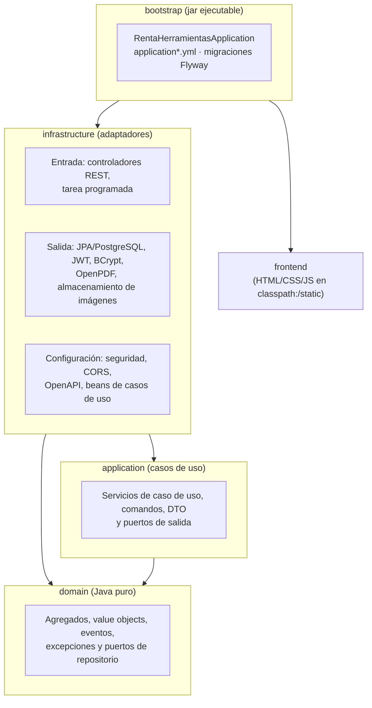

| Módulo | Depende de | Contenido |
|---|---|---|
| `domain` | — (solo JUnit en pruebas) | Agregados (`Reserva`, `Herramienta`, `Usuario`, `Pago`, `Factura`…), value objects (`Dinero`, `RangoFechas`, `Email`…), reglas de negocio y puertos de repositorio |
| `application` | `domain` | Casos de uso (`CrearReservaService`, `PagarReservaService`…), comandos, DTO de respuesta y puertos de salida (`GeneradorPdfFactura`, `UnidadDeTrabajo`…) |
| `infrastructure` | `application`, `domain`, Spring | Adaptadores de entrada (REST, scheduler) y de salida (JPA, JWT, PDF, archivos), seguridad y configuración |
| `frontend` | — | Páginas, estilos y scripts estáticos |
| `bootstrap` | `infrastructure`, `frontend` | Clase `main`, `application*.yml`, migraciones y pruebas de integración |

### DDD: bounded contexts

Cada contexto tiene el mismo esqueleto en las tres capas (`domain/<bc>`, `application/<bc>`,
`infrastructure/<bc>`). Cuando un contexto necesita datos de otro lo hace **a través de un
puerto propio** implementado por un adaptador (nunca importando el modelo del otro).

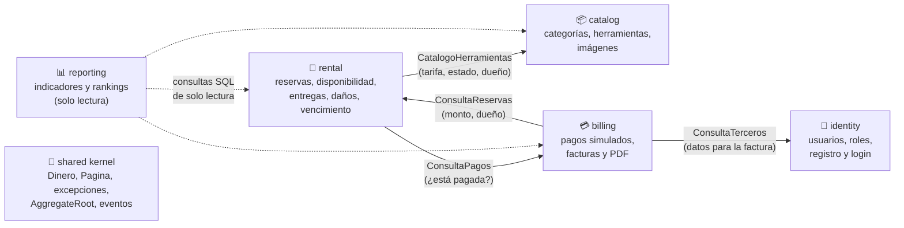

| Contexto | Agregados / conceptos | Reglas destacadas |
|---|---|---|
| **identity** | `Usuario` (+ `DatosProveedor`, `DatosCliente`) | Email único, un solo rol, NIT/documento con formato válido, borrado lógico |
| **catalog** | `Categoria`, `Herramienta` | Una fila = una unidad física; estados `DISPONIBLE`, `EN_MANTENIMIENTO`, `DANADA`, `INACTIVA` |
| **rental** | `Reserva` (+ `ReporteDanio`) | Máquina de estados, máx. 30 días, sin solapamientos (dominio + `EXCLUDE` en BD), vencimiento automático |
| **billing** | `Pago`, `Factura` | El monto lo calcula el servidor; tarjeta/PSE se aprueban al instante, efectivo queda `PENDIENTE` hasta que el proveedor lo confirma; numeración `FAC-AAAA-NNNNNN` |
| **reporting** | Vistas de lectura | Ingresos por mes, ranking de herramientas y clientes, inventario, rentabilidad |

Ciclo de vida de una reserva:

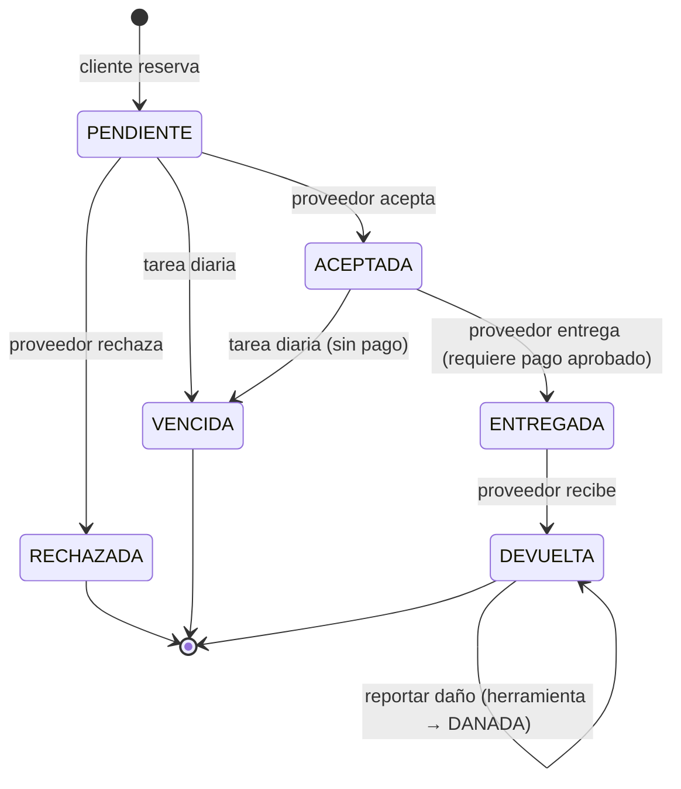

---

## 🚀 Instalación y ejecución

Requisitos: **Git** y **Docker** (opción A), o **JDK 21 + Maven 3.9+ + Docker/PostgreSQL 17**
(opción B). Detalles y solución de problemas en [COMPILACION.md](COMPILACION.md).

```bash
git clone https://github.com/manuelisaaccamanidiaz-lgtm/Proyecto_RentaHerramientas_CamanoManuel.git proyecto-rentaherramientas
cd proyecto-rentaherramientas
cp .env.example .env        # en Windows (PowerShell): Copy-Item .env.example .env
```

Edita `.env` y cambia al menos `POSTGRES_PASSWORD` y `JWT_SECRET` (mínimo 32 bytes).

### Opción A · Todo con Docker 🐳 (recomendada)

```bash
docker compose up --build
```

- Frontend: <http://localhost:8080>
- Swagger UI: <http://localhost:8080/swagger-ui.html>
- Salud: <http://localhost:8080/actuator/health> → `{"status":"UP"}`

Arranca en perfil **dev** con los datos semilla. Para producción, logs, `down -v` y
variables, ver [DESPLIEGUE.md](DESPLIEGUE.md).

### Opción B · Sin Docker para la app

```bash
docker compose up -d postgres          # o un PostgreSQL 17 propio con los datos de .env
mvn clean install -DskipTests          # compila los 5 módulos
java -jar bootstrap/target/bootstrap-1.0-SNAPSHOT.jar
```

Lanza el jar **desde la raíz del proyecto**: el perfil dev lee `./.env` (también prueba
`../.env` si se arranca desde `bootstrap/`). Desde el IDE, ejecuta
`RentaHerramientasApplication` con el directorio de trabajo en la raíz.

---

## ⚙️ Configuración

La configuración está en `bootstrap/src/main/resources/` y se divide por perfil:

| Archivo | Contenido |
|---|---|
| `application.yml` | Común: JPA en `validate`, Flyway, límites de subida, actuator, propiedades `app.*` |
| `application-dev.yml` | Importa `.env`, valores por defecto locales, datos semilla, SQL en el log |
| `application-prod.yml` | Sin `.env` ni valores por defecto: si falta una variable, la app no arranca |

El perfil se elige con `SPRING_PROFILES_ACTIVE` (por defecto `dev`).

### Ejemplo en `application.yml` (formato que usa el proyecto)

```yaml
spring:
  application:
    name: renta-herramientas
  profiles:
    active: ${SPRING_PROFILES_ACTIVE:dev}
  datasource:
    url: jdbc:postgresql://${POSTGRES_HOST:localhost}:${POSTGRES_PORT:5432}/${POSTGRES_DB:rentaherramientas}
    username: ${POSTGRES_USER:renta_user}
    password: ${POSTGRES_PASSWORD:}
  jpa:
    hibernate:
      ddl-auto: validate          # el esquema lo gobierna Flyway
    open-in-view: false
  flyway:
    enabled: true
    locations: classpath:db/migration,classpath:db/seed   # db/seed solo en dev
  servlet:
    multipart:
      max-file-size: 5MB
      max-request-size: 6MB

management:
  endpoints:
    web:
      exposure:
        include: health

app:
  jwt:
    secret: ${JWT_SECRET}                      # HS256, mínimo 32 bytes
    expiracion-minutos: ${JWT_EXPIRACION_MINUTOS:60}
  cors:
    allowed-origins: ${CORS_ALLOWED_ORIGINS:http://localhost:5173}
  admin:
    email: ${ADMIN_EMAIL:}
    password: ${ADMIN_PASSWORD:}
  uploads:
    dir: ${UPLOADS_DIR:./uploads}
  reservas:
    cron-vencimiento: ${RESERVAS_CRON_VENCIMIENTO:0 5 0 * * *}
```

### Equivalente en `application.properties`

```properties
spring.application.name=renta-herramientas
spring.profiles.active=${SPRING_PROFILES_ACTIVE:dev}
spring.datasource.url=jdbc:postgresql://${POSTGRES_HOST:localhost}:${POSTGRES_PORT:5432}/${POSTGRES_DB:rentaherramientas}
spring.datasource.username=${POSTGRES_USER:renta_user}
spring.datasource.password=${POSTGRES_PASSWORD:}
# El esquema lo gobierna Flyway; Hibernate solo valida.
spring.jpa.hibernate.ddl-auto=validate
spring.jpa.open-in-view=false
spring.flyway.enabled=true
# db/seed solo en dev
spring.flyway.locations=classpath:db/migration,classpath:db/seed
spring.servlet.multipart.max-file-size=5MB
spring.servlet.multipart.max-request-size=6MB

management.endpoints.web.exposure.include=health

# HS256, mínimo 32 bytes
app.jwt.secret=${JWT_SECRET}
app.jwt.expiracion-minutos=${JWT_EXPIRACION_MINUTOS:60}
app.cors.allowed-origins=${CORS_ALLOWED_ORIGINS:http://localhost:5173}
app.admin.email=${ADMIN_EMAIL:}
app.admin.password=${ADMIN_PASSWORD:}
app.uploads.dir=${UPLOADS_DIR:./uploads}
app.reservas.cron-vencimiento=${RESERVAS_CRON_VENCIMIENTO:0 5 0 * * *}
```

### Variables de entorno (`.env`)

| Variable | Ejemplo | Descripción |
|---|---|---|
| `POSTGRES_HOST` / `POSTGRES_PORT` | `localhost` / `5432` | Servidor de BD (en Docker se fuerza `postgres:5432`) |
| `POSTGRES_DB` / `POSTGRES_USER` / `POSTGRES_PASSWORD` | `rentaherramientas` / `renta_user` / … | Base de datos y credenciales |
| `SPRING_PROFILES_ACTIVE` | `dev` | `dev` (semilla) o `prod` |
| `APP_PORT` | `8080` | Puerto publicado por docker compose |
| `JWT_SECRET` | `openssl rand -base64 48` | Secreto HS256 (≥ 32 bytes) |
| `JWT_EXPIRACION_MINUTOS` | `60` | Vida del token |
| `ADMIN_EMAIL` / `ADMIN_PASSWORD` | `admin@rentaherramientas.local` | Admin inicial (se crea si no existe; vacío = no se crea) |
| `CORS_ALLOWED_ORIGINS` | `http://localhost:5173` | Orígenes externos permitidos (el frontend incluido no lo necesita) |
| `UPLOADS_DIR` | `./uploads` | Carpeta de imágenes subidas (en Docker: volumen `/uploads`) |
| `RESERVAS_CRON_VENCIMIENTO` | `0 5 0 * * *` | Cron de la tarea que vence reservas (hora de Bogotá) |

---

## 🗄️ Base de datos

### Diagrama relacional

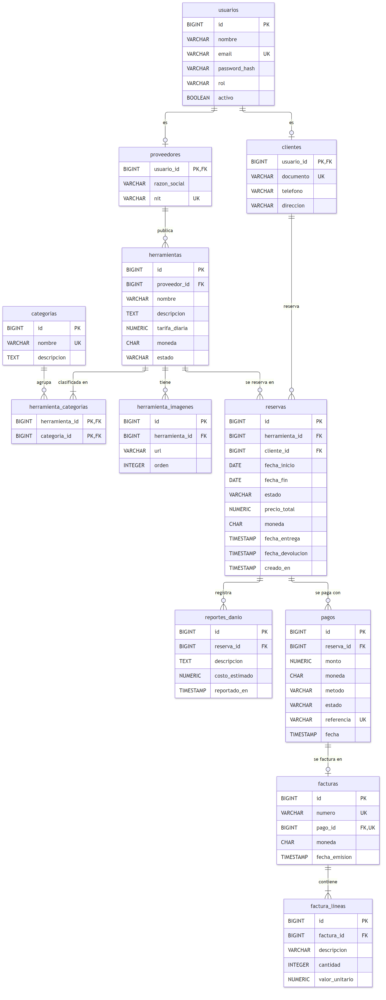

Generado con `@mermaid-js/mermaid-cli` desde el bloque Mermaid de
[docs/NORMALIZACION.md](docs/NORMALIZACION.md#4-diagrama-entidad-relación).

### Migraciones Flyway

| Versión | Contenido |
|---|---|
| `V1__identity` | `usuarios`, `proveedores`, `clientes` |
| `V2__catalog` | `categorias`, `herramientas`, `herramienta_imagenes`, `herramienta_categorias` |
| `V3__rental` | `reservas`, `reportes_danio` y sus CHECK de coherencia estado ↔ fechas |
| `V4__billing` | `pagos`, `facturas`, `factura_lineas` |
| `V5__reservas_sin_solapamiento` | Restricción `EXCLUDE USING gist` (sin rangos cruzados por herramienta) |
| `V6__secuencia_facturas` | Secuencia para la numeración de facturas |
| `V100__datos_semilla` *(solo dev)* | 1 admin, 20 proveedores, 25 clientes, 20 categorías, 40 herramientas, reservas, pagos y facturas |

### Normalización hasta 4FN ✅

Las 12 tablas cumplen 1FN, 2FN, 3FN, FNBC y 4FN. Decisiones principales:

- **4FN:** las imágenes y las categorías de una herramienta son listas independientes, por
  eso viven en `herramienta_imagenes` y `herramienta_categorias` (juntas obligarían a
  guardar todas las combinaciones).
- **3FN:** se eliminó `facturas.reserva_id` (se deduce por `facturas.pago_id → pagos.reserva_id`)
  y `factura_lineas` no guarda el subtotal (derivable).
- **Subtipos 1:1** `proveedores` y `clientes` para no dejar columnas nulas en `usuarios`.
- `reservas.precio_total` se conserva a propósito: es la foto del precio al reservar.

Análisis completo tabla por tabla: [docs/NORMALIZACION.md](docs/NORMALIZACION.md).

---

## 🔐 Autenticación JWT y roles

### Flujo

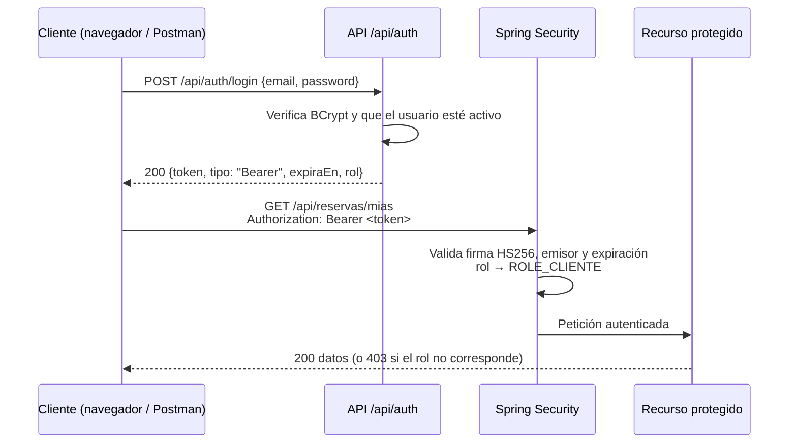

1. `POST /api/auth/registro` crea un **CLIENTE** o un **PROVEEDOR** (los ADMIN no se
   registran: se crean con `ADMIN_EMAIL`/`ADMIN_PASSWORD` o desde la semilla).
2. `POST /api/auth/login` devuelve el token.
3. Cada petición protegida envía `Authorization: Bearer <token>`. No hay sesión en el
   servidor (`STATELESS`); CSRF está desactivado porque no se usan cookies.
4. Sin token o con token inválido/vencido → **401**. Con token válido pero rol sin permiso → **403**.

### Claims del token

| Claim | Ejemplo | Significado |
|---|---|---|
| `iss` | `renta-herramientas` | Emisor; se valida al recibir el token |
| `sub` | `22` | Id del usuario |
| `email` | `andres.rueda@gmail.com` | Email del usuario |
| `rol` | `CLIENTE` | `ADMIN`, `PROVEEDOR` o `CLIENTE` → autoridad `ROLE_<rol>` |
| `iat` / `exp` | `1792092747` / `1792096347` | Emisión y expiración (epoch, segundos) |

Firma **HS256** con `JWT_SECRET`. Duración: **60 minutos** por defecto
(`JWT_EXPIRACION_MINUTOS`). No hay refresh token: al vencer, se vuelve a iniciar sesión
(el frontend redirige al login automáticamente).

### Roles y permisos

| Rol | Puede |
|---|---|
| **Público** | Ver catálogo, categorías, detalle y disponibilidad de herramientas; registrarse e iniciar sesión |
| **CLIENTE** | Reservar, ver sus reservas, pagar, ver sus pagos y facturas, descargar PDF, editar su perfil |
| **PROVEEDOR** | Gestionar sus herramientas e imágenes; aceptar/rechazar, entregar, recibir y reportar daños en reservas de sus herramientas; confirmar pagos en efectivo; ver sus pagos, facturas y resumen |
| **ADMIN** | Todo lo anterior sobre cualquier recurso, más categorías, usuarios (activar/desactivar), historiales completos y reportes |

La regla de **propiedad** (solo el proveedor dueño gestiona sus herramientas y reservas)
la aplican los casos de uso; Spring Security filtra por rol.

### Usarlo en Swagger UI

1. Abre <http://localhost:8080/swagger-ui.html>.
2. Ejecuta `POST /api/auth/login` (sección *Autenticación*) con un usuario de prueba.
3. Copia el valor de `token` (sin comillas).
4. Pulsa **Authorize** 🔓, pega el token (sin escribir `Bearer`) y confirma.
5. Desde ese momento Swagger envía el header en todas las peticiones.

### Usarlo en Postman

1. Importa [docs/postman/RentaHerramientas.postman_collection.json](docs/postman/RentaHerramientas.postman_collection.json).
2. Revisa las variables de la colección (`baseUrl`, emails y contraseñas).
3. Ejecuta las peticiones de **1. Autenticación**: los scripts guardan `tokenAdmin`,
   `tokenProveedor` y `tokenCliente`, y cada carpeta ya usa *Bearer Token* con la variable
   correspondiente. Los ids creados (`herramientaId`, `reservaId`, `pagoId`…) también se
   guardan solos, así que la colección se puede correr en orden con el *Runner*.
4. Manualmente: pestaña **Authorization → Bearer Token → `{{tokenCliente}}`**.

---

## 👥 Usuarios de prueba

Disponibles en el perfil **dev** (datos semilla). Contraseña de **todos**: `Clave123*`

| Rol | Email | Nombre |
|---|---|---|
| ADMIN | `admin@rentaherramientas.co` | Administración Renta de Herramientas |
| PROVEEDOR | `carlos.rueda@ferreteriaeltornillo.co` | Carlos Rueda Pinzón · Ferretería El Tornillo SAS |
| PROVEEDOR | `ventas@herramientasdeloriente.co` | Martha Lucía Ardila · Herramientas del Oriente SAS |
| CLIENTE | `andres.rueda@gmail.com` | Andrés Felipe Rueda Pinzón |
| CLIENTE | `mcamila.ortiz@hotmail.com` | María Camila Ortiz Suárez |

Hay 20 proveedores y 25 clientes en total (ver `db/seed/V100__datos_semilla.sql`). Además,
al arrancar se crea el admin de `ADMIN_EMAIL`/`ADMIN_PASSWORD` del `.env` si no existe.

---

## 🌐 Endpoints de la API

Base: `http://localhost:8080`. Todo el detalle interactivo (esquemas, validaciones,
códigos de respuesta) está en **Swagger UI**; aquí va la lista completa con ejemplos.

### Convenciones

- **JSON** en peticiones y respuestas; fechas ISO (`2026-11-04`, `2026-10-14T10:15:00`).
- **Paginación** en listados: parámetros `page` (desde 0) y `size` (máx. 50). Respuesta:

  ```json
  { "contenido": [ … ], "pagina": 0, "tamano": 10, "totalElementos": 38, "totalPaginas": 4 }
  ```

- **Errores** con *Problem Details* (RFC 9457). Las validaciones incluyen `errores` por campo:

  ```json
  {
    "status": 400, "title": "Datos inválidos", "detail": "La petición tiene campos inválidos",
    "instance": "/api/auth/registro",
    "errores": { "email": "must be a well-formed email address", "rol": "must not be null" }
  }
  ```

  | Código | Cuándo |
  |---|---|
  | 400 | Datos inválidos o regla de valor (p. ej. fecha de inicio en el pasado) |
  | 401 | Sin token, token inválido/vencido o credenciales incorrectas |
  | 403 | Rol sin permiso, recurso de otro usuario o usuario inactivo |
  | 404 | Recurso no encontrado |
  | 409 | Conflicto: email ya registrado, reserva solapada, transición de estado inválida, categoría en uso |
  | 413 | Imagen de más de 5 MB |

Columna **Rol**: 🌍 público · 🔑 cualquier usuario autenticado · `C` CLIENTE · `P` PROVEEDOR · `A` ADMIN.
La columna **Ej.** remite a los ejemplos JSON que siguen a cada tabla.

### 🔐 Identity · autenticación y usuarios

| Método | Ruta | Rol | Descripción | Ej. |
|---|---|---|---|---|
| POST | `/api/auth/registro` | 🌍 | Registra un CLIENTE o PROVEEDOR → **201** | I1 |
| POST | `/api/auth/login` | 🌍 | Inicia sesión y devuelve el JWT | I2 |
| GET | `/api/usuarios/me` | 🔑 | Perfil del usuario autenticado | I3 |
| PUT | `/api/usuarios/me` | 🔑 | Actualiza nombre y datos de su rol | I4 |
| GET | `/api/admin/usuarios?rol=&page=&size=` | A | Lista paginada de usuarios | I3 |
| GET | `/api/admin/usuarios/{id}` | A | Detalle de un usuario | I3 |
| PUT | `/api/admin/usuarios/{id}` | A | Actualiza nombre y datos de proveedor/cliente | I4 |
| PATCH | `/api/admin/usuarios/{id}/desactivar` | A | Borrado lógico (un admin no puede desactivarse a sí mismo) | I3 |
| PATCH | `/api/admin/usuarios/{id}/activar` | A | Reactiva un usuario | I3 |

**I1 · Registro** — request (cliente; un proveedor envía `"rol": "PROVEEDOR"` y
`"datosProveedor": {"razonSocial": "Ferretería El Tornillo SAS", "nit": "900101001-3"}`):

```json
{
  "nombre": "Andrés Felipe Rueda Pinzón",
  "email": "andres.rueda@gmail.com",
  "password": "Clave123*",
  "rol": "CLIENTE",
  "datosCliente": {
    "documento": "1098654321",
    "telefono": "3157894561",
    "direccion": "Cra 33 # 48-25, Cabecera del Llano, Bucaramanga"
  }
}
```

Response **201**: igual a I3.

**I2 · Login** — request y response **200**:

```json
{ "email": "andres.rueda@gmail.com", "password": "Clave123*" }
```

```json
{
  "token": "eyJhbGciOiJIUzI1NiJ9.eyJpc3MiOiJyZW50YS1oZXJyYW1pZW50YXMiLCJzdWIiOiIyMiIs…",
  "tipo": "Bearer",
  "expiraEn": "2026-10-15T20:32:27.816822234Z",
  "rol": "CLIENTE"
}
```

**I3 · Usuario** — response **200**:

```json
{
  "id": 22,
  "nombre": "Andrés Felipe Rueda Pinzón",
  "email": "andres.rueda@gmail.com",
  "rol": "CLIENTE",
  "activo": true,
  "datosProveedor": null,
  "datosCliente": {
    "documento": "1098654321",
    "telefono": "3157894561",
    "direccion": "Cra 33 # 48-25, Cabecera del Llano, Bucaramanga"
  }
}
```

**I4 · Actualizar usuario** — request (solo se envía el bloque del rol del usuario); response: I3.

```json
{
  "nombre": "Carlos Rueda Pinzón",
  "datosProveedor": { "razonSocial": "Ferretería El Tornillo SAS", "nit": "900101001-3" }
}
```

### 📦 Catalog · categorías, herramientas e imágenes

| Método | Ruta | Rol | Descripción | Ej. |
|---|---|---|---|---|
| GET | `/api/categorias` | 🌍 | Lista todas las categorías | K1 |
| GET | `/api/categorias/{id}` | 🌍 | Detalle de una categoría | K1 |
| POST | `/api/categorias` | A | Crea una categoría → **201** | K1 |
| PUT | `/api/categorias/{id}` | A | Actualiza una categoría | K1 |
| DELETE | `/api/categorias/{id}` | A | Elimina una categoría sin herramientas → **204** (409 si está en uso) | — |
| GET | `/api/herramientas?categoriaId=&estado=&texto=&proveedorId=&page=&size=` | 🌍 | Catálogo con filtros y paginación | K2 |
| GET | `/api/herramientas/{id}` | 🌍 | Detalle de una herramienta | K2 |
| POST | `/api/herramientas` | P | Registra una herramienta del proveedor autenticado → **201** | K2 |
| PUT | `/api/herramientas/{id}` | P (dueño), A | Actualiza datos, tarifa y categorías | K2 |
| PATCH | `/api/herramientas/{id}/estado` | P (dueño), A | Cambia el estado operativo | K3 |
| DELETE | `/api/herramientas/{id}` | P (dueño), A | Baja lógica (queda `INACTIVA`) → **204** | — |
| GET | `/api/proveedor/herramientas?categoriaId=&estado=&texto=&page=&size=` | P | Inventario propio, incluidas las inactivas | K2 |
| POST | `/api/herramientas/{id}/imagenes` | P (dueño), A | Sube una imagen (`multipart/form-data`, campo `archivo`, máx. 5 MB) → **201** | K4 |
| DELETE | `/api/herramientas/{id}/imagenes/{orden}` | P (dueño), A | Quita la imagen de esa posición | K2 |

**K1 · Categoría** — request y response:

```json
{ "nombre": "Andamios y escaleras", "descripcion": "Andamios certificados y escaleras para trabajo en alturas." }
```

```json
{ "id": 5, "nombre": "Andamios y escaleras", "descripcion": "Andamios certificados y escaleras para trabajo en alturas." }
```

**K2 · Herramienta** — request (`moneda` es opcional, por defecto `COP`) y response:

```json
{
  "nombre": "Taladro percutor Bosch GSB 13 RE 650W",
  "descripcion": "Taladro percutor con mandril de 13 mm, velocidad variable y reversa.",
  "tarifaDiaria": 25000,
  "moneda": "COP",
  "categoriaIds": [1, 13]
}
```

```json
{
  "id": 1,
  "proveedorId": 2,
  "nombre": "Taladro percutor Bosch GSB 13 RE 650W",
  "descripcion": "Taladro percutor con mandril de 13 mm, velocidad variable y reversa.",
  "tarifaDiaria": 25000,
  "moneda": "COP",
  "estado": "DISPONIBLE",
  "categoriaIds": [1, 13],
  "imagenes": [ { "orden": 1, "url": "/img/seed/taladro.webp" } ]
}
```

**K3 · Cambiar estado** — `DISPONIBLE`, `EN_MANTENIMIENTO`, `DANADA` o `INACTIVA`
(una herramienta `DANADA` pasa primero a `EN_MANTENIMIENTO`); response: K2.

```json
{ "estado": "EN_MANTENIMIENTO" }
```

**K4 · Subir imagen**

```bash
curl -X POST http://localhost:8080/api/herramientas/1/imagenes \
  -H "Authorization: Bearer $TOKEN" -F "archivo=@taladro.png"
```

Response **201**: K2 con la nueva imagen (`"url": "/uploads/31603bf4-….png"`).

### 📅 Rental · reservas y disponibilidad

| Método | Ruta | Rol | Descripción | Ej. |
|---|---|---|---|---|
| GET | `/api/herramientas/{id}/disponibilidad?desde=&hasta=` | 🌍 | Rangos ocupados de una herramienta | R1 |
| POST | `/api/reservas` | C | Solicita una reserva (queda `PENDIENTE`) → **201** (409 si se solapa) | R2 |
| GET | `/api/reservas/mias?estado=&page=&size=` | C | Reservas del cliente autenticado | R2 |
| GET | `/api/reservas/{id}` | 🔑 | Detalle (su cliente, el proveedor dueño o un ADMIN) | R2 |
| GET | `/api/proveedor/reservas?estado=&page=&size=` | P | Reservas de las herramientas del proveedor | R2 |
| GET | `/api/admin/reservas?estado=&clienteId=&herramientaId=&desde=&hasta=&page=&size=` | A | Historial con filtros | R2 |
| PATCH | `/api/reservas/{id}/aceptar` | P (dueño), A | `PENDIENTE` → `ACEPTADA` | R2 |
| PATCH | `/api/reservas/{id}/rechazar` | P (dueño), A | `PENDIENTE` → `RECHAZADA` | R2 |
| PATCH | `/api/reservas/{id}/entregar` | P (dueño), A | `ACEPTADA` y pagada → `ENTREGADA` | R2 |
| PATCH | `/api/reservas/{id}/devolver` | P (dueño), A | `ENTREGADA` → `DEVUELTA` | R2 |
| POST | `/api/reservas/{id}/danios` | P (dueño), A | Reporta un daño en una reserva `DEVUELTA` (herramienta → `DANADA`) → **201** | R3 |

**R1 · Disponibilidad** — response:

```json
{
  "herramientaId": 2,
  "desde": "2026-10-15",
  "hasta": "2027-04-13",
  "ocupados": [ { "inicio": "2026-10-13", "fin": "2026-10-17" } ]
}
```

**R2 · Reserva** — request (fechas incluidas, máx. 30 días, inicio desde hoy) y response:

```json
{ "herramientaId": 2, "fechaInicio": "2026-11-04", "fechaFin": "2026-11-06" }
```

```json
{
  "id": 34,
  "herramientaId": 2,
  "clienteId": 22,
  "fechaInicio": "2026-11-04",
  "fechaFin": "2026-11-06",
  "dias": 3,
  "estado": "PENDIENTE",
  "precioTotal": 90000,
  "moneda": "COP",
  "pagada": false,
  "fechaEntrega": null,
  "fechaDevolucion": null,
  "creadoEn": "2026-10-15T14:05:12",
  "reportesDanio": []
}
```

**R3 · Reporte de daño** — request (`costoEstimado` opcional); response: R2 con el reporte:

```json
{ "descripcion": "Carcasa rayada y mandril con juego", "costoEstimado": 25000 }
```

```json
"reportesDanio": [
  { "descripcion": "Carcasa rayada y mandril con juego", "costoEstimado": 25000, "reportadoEn": "2026-10-15T14:06:40" }
]
```

### 💳 Billing · pagos y facturas

| Método | Ruta | Rol | Descripción | Ej. |
|---|---|---|---|---|
| POST | `/api/pagos` | C | Paga una reserva `ACEPTADA` propia → **201** | B1 |
| GET | `/api/pagos/mios?page=&size=` | C | Pagos del cliente | B1 |
| GET | `/api/pagos/{id}` | 🔑 | Detalle (cliente, proveedor dueño o ADMIN) | B1 |
| PATCH | `/api/pagos/{id}/confirmar` | P (dueño), A | Confirma un pago en efectivo `PENDIENTE` y emite la factura | B1 |
| PATCH | `/api/pagos/{id}/rechazar` | P (dueño), A | Rechaza un pago `PENDIENTE` | B1 |
| GET | `/api/proveedor/pagos?page=&size=` | P | Pagos de reservas de sus herramientas | B1 |
| GET | `/api/admin/pagos?estado=&metodo=&desde=&hasta=&page=&size=` | A | Historial de pagos con filtros | B1 |
| GET | `/api/facturas/mias?page=&size=` | C | Facturas del cliente | B2 |
| GET | `/api/facturas/{id}` | 🔑 | Detalle (cliente, proveedor dueño o ADMIN) | B2 |
| GET | `/api/facturas/{id}/pdf` | 🔑 | Descarga la factura (`application/pdf`, `FAC-2026-000001.pdf`) | — |
| GET | `/api/proveedor/facturas?page=&size=` | P | Facturas de sus herramientas | B2 |
| GET | `/api/admin/facturas?page=&size=` | A | Todas las facturas | B2 |

**B1 · Pago** — request (`TARJETA`, `PSE` o `EFECTIVO`; el monto lo calcula el
servidor) y response. Tarjeta y PSE quedan `APROBADO` con factura; efectivo queda
`PENDIENTE` y `factura: null` hasta que el proveedor lo confirma.

```json
{ "reservaId": 2, "metodo": "TARJETA" }
```

```json
{
  "id": 1,
  "reservaId": 2,
  "monto": 75000,
  "moneda": "COP",
  "metodo": "TARJETA",
  "estado": "APROBADO",
  "referencia": "PAG-2026-SEED0001",
  "fecha": "2026-08-15T15:00:00",
  "factura": { "id": 1, "numero": "FAC-2026-000001", "total": 75000 }
}
```

**B2 · Factura** — response:

```json
{
  "id": 1,
  "numero": "FAC-2026-000001",
  "pagoId": 1,
  "fechaEmision": "2026-08-15T15:01:00",
  "moneda": "COP",
  "lineas": [
    {
      "descripcion": "Alquiler de Taladro percutor Bosch GSB 13 RE 650W del 16/08/2026 al 18/08/2026",
      "cantidad": 3,
      "valorUnitario": 25000,
      "subtotal": 75000
    }
  ],
  "total": 75000
}
```

### 📊 Reporting · reportes

| Método | Ruta | Rol | Descripción | Ej. |
|---|---|---|---|---|
| GET | `/api/proveedor/reportes/resumen` | P | Ingresos, reservas y herramientas por estado (solo las suyas) | G1 |
| GET | `/api/admin/reportes/resumen` | A | Totales de la plataforma | G2 |
| GET | `/api/admin/reportes/ingresos?desde=&hasta=` | A | Ingresos (pagos aprobados) por mes | G3 |
| GET | `/api/admin/reportes/herramientas-mas-alquiladas?limite=` | A | Ranking de herramientas (límite 1–50) | G4 |
| GET | `/api/admin/reportes/clientes-frecuentes?limite=` | A | Ranking de clientes (límite 1–50) | G5 |
| GET | `/api/admin/reportes/inventario` | A | Herramientas por estado y por categoría | G6 |
| GET | `/api/admin/reportes/rentabilidad?limite=` | A | Ingresos por herramienta y por proveedor | G7 |

```jsonc
// G1 · resumen del proveedor
{ "proveedorId": 2, "ingresosPorMoneda": { "COP": 300000 }, "pagosAprobados": 3,
  "reservasPorEstado": { "DEVUELTA": 2, "ENTREGADA": 1 }, "herramientasPorEstado": { "DISPONIBLE": 2 } }

// G2 · resumen general
{ "ingresosPorMoneda": { "COP": 2492000 }, "pagosAprobados": 20, "facturasEmitidas": 20,
  "reservasPorEstado": { "ACEPTADA": 5, "DEVUELTA": 12, "ENTREGADA": 5, "PENDIENTE": 3, "RECHAZADA": 2, "VENCIDA": 3 },
  "usuariosPorRol": { "ADMIN": 2, "CLIENTE": 25, "PROVEEDOR": 20 },
  "herramientasPorEstado": { "DANADA": 3, "DISPONIBLE": 33, "EN_MANTENIMIENTO": 2, "INACTIVA": 2 } }

// G3 · ingresos por mes
[ { "mes": "2026-08", "moneda": "COP", "total": 404000, "pagos": 4 },
  { "mes": "2026-09", "moneda": "COP", "total": 970000, "pagos": 8 } ]

// G4 · herramientas más alquiladas
[ { "herramientaId": 1, "nombre": "Taladro percutor Bosch GSB 13 RE 650W",
    "proveedor": "Ferretería El Tornillo SAS", "alquileres": 2, "diasAlquilada": 6 } ]

// G5 · clientes frecuentes
[ { "clienteId": 35, "nombre": "Mariana Isabel Quintero", "email": "mariana.quintero@hotmail.com",
    "alquileres": 1, "moneda": "COP", "totalPagado": 360000 } ]

// G6 · inventario
{ "totalHerramientas": 40,
  "porEstado": { "DANADA": 3, "DISPONIBLE": 33, "EN_MANTENIMIENTO": 2, "INACTIVA": 2 },
  "porCategoria": [ { "categoriaId": 2, "categoria": "Corte", "herramientas": 7 } ] }

// G7 · rentabilidad
{ "porHerramienta": [ { "herramientaId": 4, "nombre": "Martillo demoledor Bosch GSH 11 E",
      "proveedor": "Herramientas del Oriente SAS", "moneda": "COP", "ingresos": 360000, "pagos": 1 } ],
  "porProveedor": [ { "proveedorId": 3, "razonSocial": "Herramientas del Oriente SAS",
      "moneda": "COP", "ingresos": 540000, "pagos": 2 } ] }
```

### 🩺 Operación

| Método | Ruta | Rol | Descripción |
|---|---|---|---|
| GET | `/actuator/health` | 🌍 | `{"status":"UP"}` (healthcheck de Docker) |
| GET | `/swagger-ui.html` | 🌍 | Swagger UI |
| GET | `/v3/api-docs` | 🌍 | Especificación OpenAPI 3 en JSON |

---

## 🧪 Pruebas

| Tipo | Dónde | Qué cubren | Cómo se ejecutan |
|---|---|---|---|
| **Unitarias** (99) | `domain/src/test`, `application/src/test` | Máquina de estados de `Reserva`, `RangoFechas`, `UrlImagen`, casos de uso de reserva y pago (con dobles de prueba) | `mvn test` |
| **Integración** (5) | `bootstrap/src/test` (`*IntegrationTest`) | App completa + PostgreSQL 17 real (Testcontainers + `@ServiceConnection`) | `mvn verify` |

```bash
mvn test            # solo unitarias (surefire); no necesita Docker
mvn verify          # unitarias + integración (failsafe); necesita Docker encendido
mvn -pl bootstrap -am verify -Dtest=none -Dsurefire.failIfNoSpecifiedTests=false   # solo integración
```

Pruebas de integración:

- **`AuthIntegrationTest`**: registro → login → `GET /api/usuarios/me` **200**; sin token **401**;
  un CLIENTE en `/api/admin/**` **403**.
- **`ReservaIntegrationTest`**: flujo crear → aceptar → pagar → entregar → devolver;
  una reserva que se cruza con otra de la misma herramienta → **409**.

Usan el perfil `test` (`bootstrap/src/test/resources/application-test.yml`): sin datos
semilla, cada prueba crea sus propios usuarios, categoría y herramienta. El contenedor de
PostgreSQL se comparte entre las clases porque comparten el contexto de Spring.

Los reportes quedan en `*/target/surefire-reports` y `bootstrap/target/failsafe-reports`.

---

## 🖼️ Capturas


| Pantalla | Captura |
|---|---|
| Inicio y catálogo | 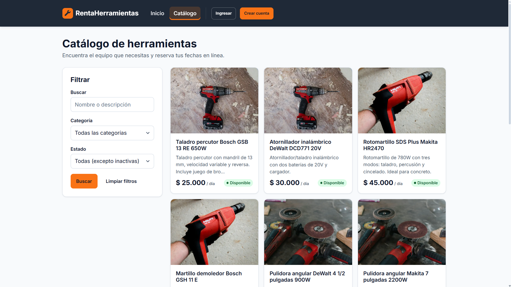 |
| Ficha de herramienta con calendario | 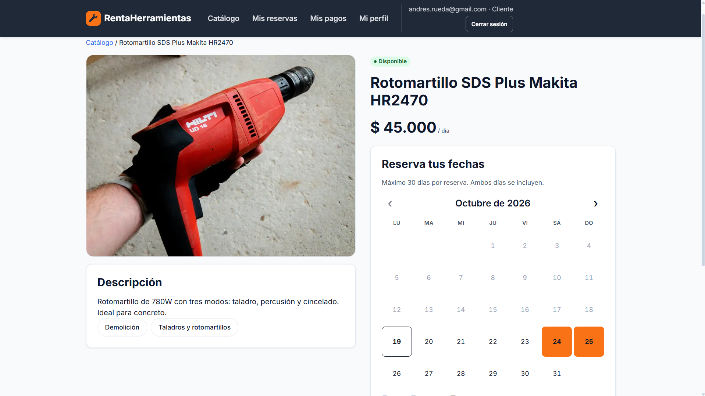 |
| Cliente · mis reservas y pago | 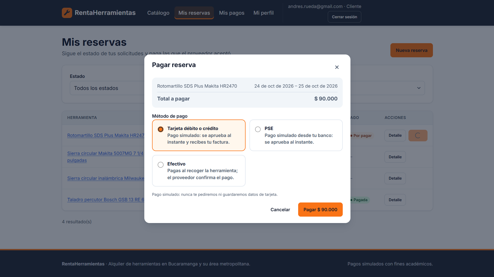 |
| Cliente · factura PDF | 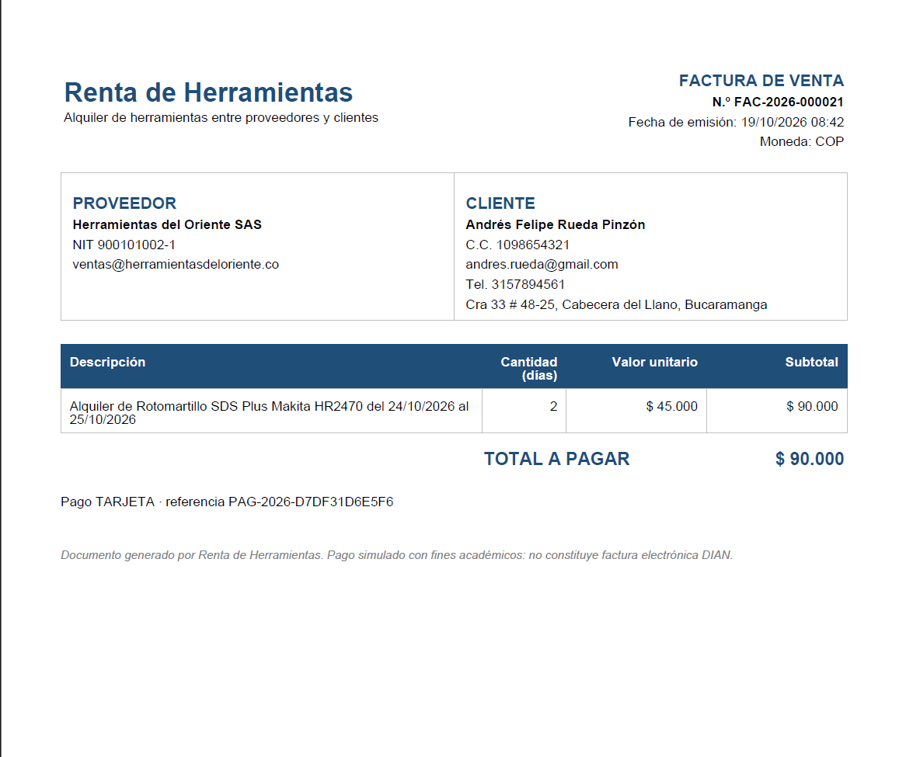 |
| Proveedor · solicitudes | 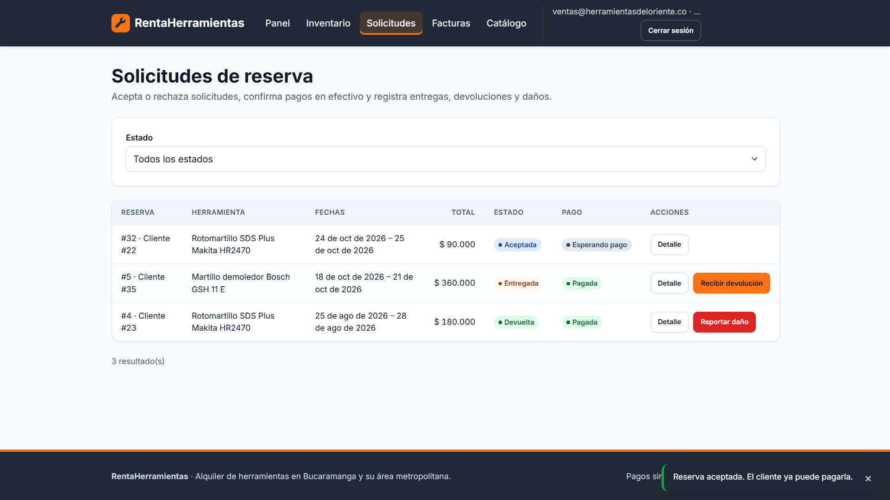 |
| Proveedor · inventario | 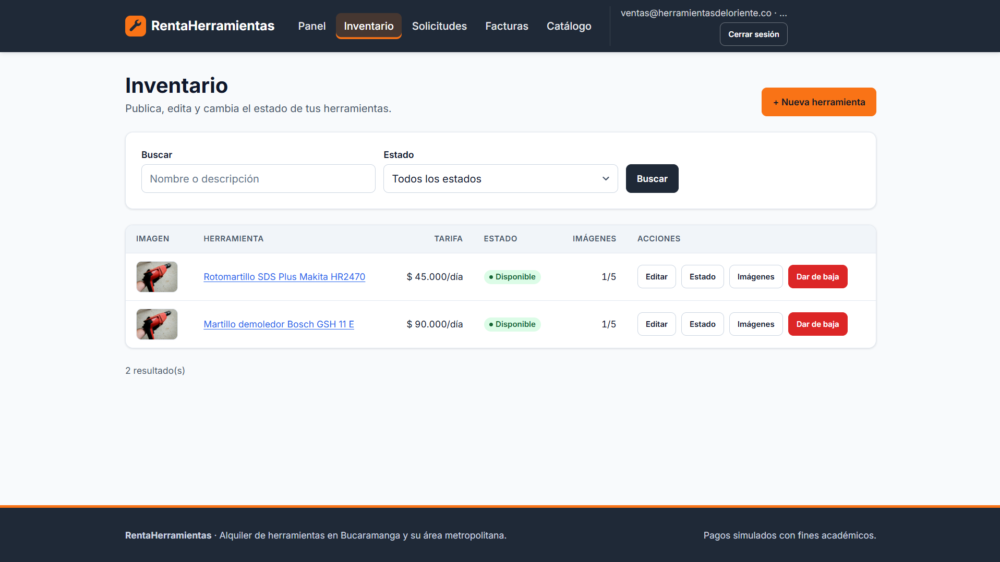 |
| Admin · panel de reportes | 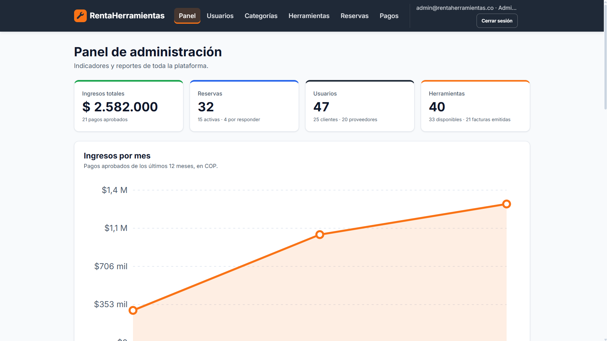 |
| Swagger UI | 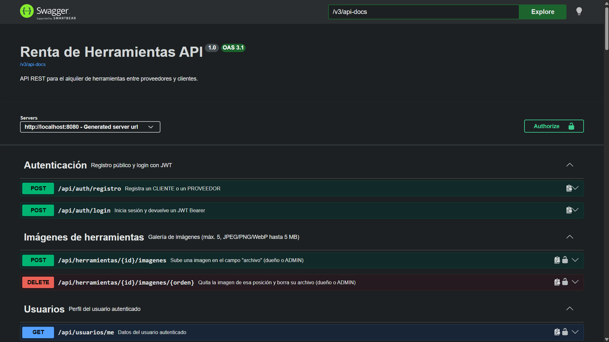 |
| Vista móvil (375 px) | 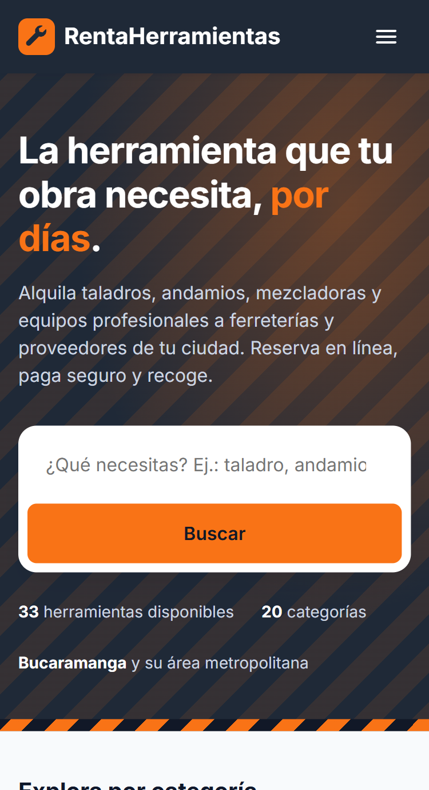 |

---

## 📚 Más documentación

| Documento | Contenido |
|---|---|
| [COMPILACION.md](COMPILACION.md) | Requisitos, compilación, pruebas, artefacto y solución de problemas |
| [DESPLIEGUE.md](DESPLIEGUE.md) | Docker paso a paso, variables, perfiles y Tomcat nativo |
| [docs/NORMALIZACION.md](docs/NORMALIZACION.md) | Normalización hasta 4FN y diagrama ER |
| [docs/postman/](docs/postman/RentaHerramientas.postman_collection.json) | Colección de Postman |
