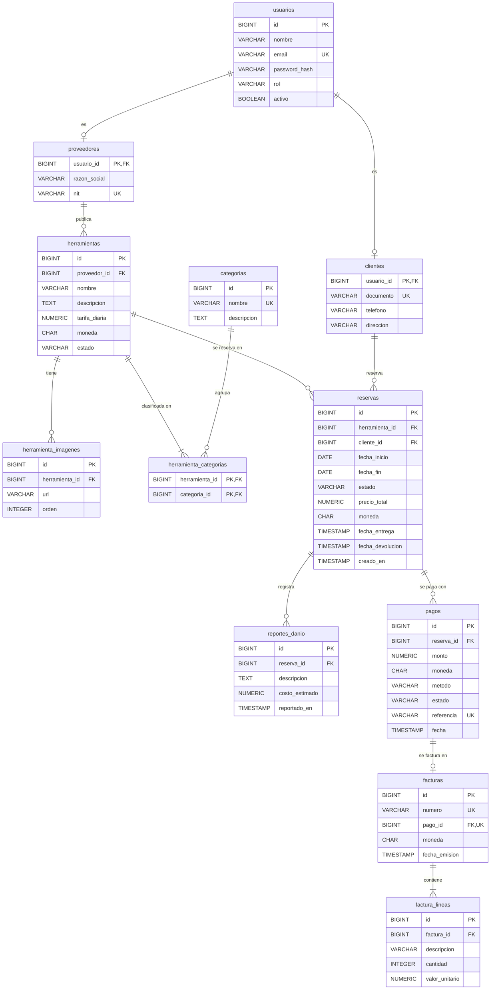

    # Normalización de la base de datos (hasta 4FN)

Plataforma de Renta de Herramientas · PostgreSQL · migraciones Flyway

## 1. Método

Cada tabla se revisó contra estas preguntas, en orden:

| Forma normal | Pregunta que se hace | Si falla… |
|---|---|---|
| **1FN** | ¿Cada columna guarda un solo valor atómico? ¿Hay listas o grupos repetidos? | Se saca la lista a una tabla hija |
| **2FN** | Con PK compuesta: ¿alguna columna depende solo de *parte* de la PK? | Se mueve a la tabla de esa parte |
| **3FN** | ¿Alguna columna depende de otra columna que no es clave (dependencia transitiva)? | Se elimina o se mueve a su propia tabla |
| **FNBC** | ¿Todo determinante (X → Y) es una clave candidata? | Se descompone la tabla |
| **4FN** | ¿Hay dos listas independientes del mismo objeto en una sola tabla (dependencia multivaluada)? | Una tabla por cada lista |

## 2. Resultado por tabla

| BC | Tabla | Clave(s) candidata(s) | 1FN | 2FN | 3FN | FNBC | 4FN | Observación |
|---|---|---|---|---|---|---|---|---|
| identity | `usuarios` | `id`, `email` | ✅ | ✅ | ✅ | ✅ | ✅ | Un usuario tiene un solo rol |
| identity | `proveedores` | `usuario_id`, `nit` | ✅ | ✅ | ✅ | ✅ | ✅ | Subtipo 1:1 de usuarios |
| identity | `clientes` **(nueva)** | `usuario_id`, `documento` | ✅ | ✅ | ✅ | ✅ | ✅ | Subtipo 1:1 de usuarios |
| catalog | `categorias` | `id`, `nombre` | ✅ | ✅ | ✅ | ✅ | ✅ | |
| catalog | `herramientas` | `id` | ✅ | ✅ | ✅ | ✅ | ✅ | Imágenes y categorías fuera (ver §3.1) |
| catalog | `herramienta_imagenes` | `id`, `(herramienta_id, orden)` | ✅ | ✅ | ✅ | ✅ | ✅ | |
| catalog | `herramienta_categorias` | `(herramienta_id, categoria_id)` | ✅ | ✅ | ✅ | ✅ | ✅ | Tabla puente N:M |
| rental | `reservas` | `id` | ✅ | ✅ | ✅ | ✅ | ✅ | Ver §3.3 |
| rental | `reportes_danio` | `id` | ✅ | ✅ | ✅ | ✅ | ✅ | |
| billing | `pagos` | `id`, `referencia` | ✅ | ✅ | ✅ | ✅ | ✅ | |
| billing | `facturas` | `id`, `numero`, `pago_id` | ✅ | ✅ | ✅* | ✅ | ✅ | *Tras quitar `reserva_id` (ver §3.2) |
| billing | `factura_lineas` | `id` | ✅ | ✅ | ✅ | ✅ | ✅ | Sin `subtotal` (derivable) |

## 3. Decisiones y cambios

### 3.1 Herramienta: imágenes y categorías en tablas separadas (el caso de 4FN)

Una herramienta tiene **varias imágenes** y **varias categorías**, y las dos listas son
independientes entre sí. Si estuvieran en una sola tabla:

| herramienta_id | imagen | categoria |
|---|---|---|
| 1 | frente.jpg | Eléctricas |
| 1 | frente.jpg | Perforación |
| 1 | lado.jpg | Eléctricas |
| 1 | lado.jpg | Perforación |

Habría que guardar **todas las combinaciones** (dependencias multivaluadas
`herramienta_id ↠ imagen` y `herramienta_id ↠ categoria`). Si se agrega una tercera
imagen, toca insertar 2 filas. Eso viola la 4FN, por eso se separan en
`herramienta_imagenes` y `herramienta_categorias`.

### 3.2 `facturas.reserva_id` eliminado (3FN)

`facturas.pago_id → pagos.reserva_id`: la reserva se deduce del pago. Guardarla otra vez
en `facturas` es un dato derivable que puede contradecirse. **Cambio:** se elimina la
columna y la factura llega a su reserva a través del pago.

### 3.3 `reservas`: columnas que *parecen* redundantes pero no lo son

- **`precio_total`**: parece derivable (`tarifa_diaria × días`), pero la tarifa de la
  herramienta puede cambiar mañana. El precio es una **foto del momento de la reserva**
  (un hecho histórico), no un cálculo sobre datos actuales. Se conserva.
- **`estado` vs `fecha_entrega` / `fecha_devolucion`**: no todos los estados se deducen
  de las fechas (`ACEPTADA`, `RECHAZADA` y `VENCIDA` no tienen fecha propia), así que
  `estado` se conserva. **Cambio:** se agregan dos CHECK para que nunca se contradigan
  (`ENTREGADA`/`DEVUELTA` ⇔ hay `fecha_entrega`; `DEVUELTA` ⇔ hay `fecha_devolucion`).

### 3.4 Nueva tabla `clientes` (requisito del enunciado)

El enunciado exige relaciones entre *Usuarios, Proveedores y Clientes*, CRUD de clientes,
20 registros por entidad y **programar entregas** (se necesita una dirección). Los datos
propios del cliente (documento, teléfono, dirección) van en un subtipo 1:1, igual que
`proveedores`, para no dejar columnas nulas en `usuarios` para admins y proveedores.
Además, `reservas.cliente_id` pasa a apuntar a `clientes(usuario_id)`: así la BD
garantiza que quien reserva es un cliente (igual que `herramientas.proveedor_id`
apunta a `proveedores`).

### 3.5 Decisión de diseño: una fila de `herramientas` = una unidad física

Si un proveedor tiene 3 taladros iguales, se registran 3 filas. Se repite nombre y
descripción, pero cada unidad tiene **su propio estado** (una puede estar dañada y otra
disponible) y **sus propias reservas**. Es una decisión consciente para simplificar el
control de disponibilidad.

### 3.6 Reglas que la BD no puede garantizar sola

Que `proveedores` solo tenga usuarios con rol `PROVEEDOR` (y `clientes` solo con rol
`CLIENTE`) es una regla entre tablas. La protege el agregado `Usuario` en el dominio.

## 4. Diagrama entidad-relación

> GitHub dibuja este diagrama automáticamente. El enunciado lo pide **en imagen**: se
> exporta a PNG el Día 7 (por ejemplo, desde <https://mermaid.live>).
